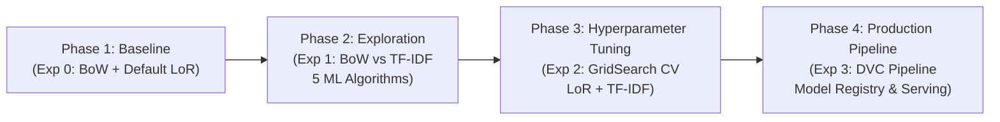
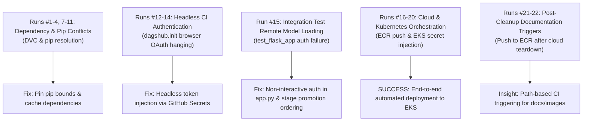

# MLOPS-PROJ-CI-CD

End-to-end MLOps project for sentiment analysis, built around experiment tracking, data versioning, automated testing, containerization, Kubernetes deployment on EKS, and observability with Prometheus and Grafana.

This README documents what was built, how the system flows, how to run it, and the proof artifacts that show the deployment working in AWS.

## Project Flow

This is the main flow of the project from experimentation to deployment:


The project takes a text input, normalizes it, converts it to features, runs the latest approved model, and serves the prediction through a Flask web app. The model lifecycle is handled with MLflow and DagsHub, the data and pipeline are managed with DVC, and the production deployment runs on AWS EKS behind a LoadBalancer service.

## Project Structure

The repository currently includes:

- Experiment notebooks for model exploration and comparison.
- A DVC pipeline for ingestion, preprocessing, feature generation, model building, evaluation, and registration.
- A Flask application for inference.
- Docker packaging for local and production use.
- GitHub Actions CI/CD for testing, building, pushing, and deploying.
- Kubernetes deployment and service manifests for EKS.
- Prometheus and Grafana monitoring setup.

The high-level execution path is:

1. Raw data is prepared and versioned through DVC.
2. Data is cleaned and transformed into model-ready features.
3. Experiments are tracked in MLflow via DagsHub.
4. The selected model is registered and promoted.
5. The Flask app loads the latest staged model and serves predictions.
6. GitHub Actions runs tests, rebuilds the container, pushes to ECR, and applies the Kubernetes manifests.
7. EKS exposes the app using a LoadBalancer service.
8. Prometheus scrapes request metrics and Grafana visualizes traffic and latency.

## What Was Done

### 1. Project scaffolding

- Created the repository structure using a data-science style project layout.
- Organized the code under src with separate packages for data, features, model, logger, and visualization.
- Added test modules and helper scripts for CI and promotion.

### 2. Data and model pipeline

- Built data ingestion and preprocessing steps.
- Added feature engineering and model-building code.
- Added evaluation and model registration steps.
- Wired the flow through dvc.yaml and params.yaml so the pipeline can be reproduced consistently.

### 3. Experiment tracking and model registry

- Connected experiment runs to [DagsHub MLflow Tracking Server](https://dagshub.com/satyagudu1146/MLOPS-PROJ-CI-CD.mlflow/#/experiments).
- Tracked 4 distinct experiment suites across baseline modeling, feature vectorization comparison, hyperparameter optimization, and DVC CI/CD pipeline runs.
- Logged parameters, metrics (Accuracy, Precision, Recall, F1, ROC-AUC), artifacts, and models across 36+ total runs.
- Registered the champion tuned model (`my_model`) in the MLflow Model Registry and loaded it dynamically in the production Flask service from `models:/my_model/Production`.
- (See detailed metrics and breakdown in the [Experiment Tracking & Model Evolution](#experiment-tracking--model-evolution) section below).

### 4. Flask inference service

- Built a simple web interface for sentiment prediction.
- Added text preprocessing inside the app before inference.
- Exposed a prediction endpoint and a Prometheus metrics endpoint.
- Added request count, latency, and prediction counters for observability.

### 5. Docker and containerization

- Packaged the Flask app into a production container.
- Exposed port 5000 and used Gunicorn for the deployment command.
- Copied the trained vectorizer into the image so the app can transform text consistently at runtime.

### 6. CI/CD with GitHub Actions

- Added a workflow that installs dependencies, verifies AWS CLI, runs DVC, executes tests, promotes the model, builds the Docker image, pushes it to ECR, and deploys to EKS.
- Used GitHub Secrets for AWS credentials and the DagsHub token.

### 7. AWS and EKS deployment

- Created an EKS cluster and node group.
- Applied a Kubernetes deployment with 2 replicas.
- Exposed the app through a LoadBalancer service.
- Stored the DagsHub token as a Kubernetes secret and injected it into the app at runtime.

### 8. Monitoring

- Added Prometheus scraping for the app metrics.
- Created Grafana dashboards to visualize request traffic and latency over time.

## Experiment Tracking & Model Evolution

All machine learning experiments and pipeline evaluations were tracked remotely using **MLflow** hosted on **DagsHub**:
🔗 **Live Tracking UI**: [DagsHub MLflow Experiments Dashboard](https://dagshub.com/satyagudu1146/MLOPS-PROJ-CI-CD.mlflow/#/experiments)

The modeling workflow followed a rigorous 4-phase iterative evolution:


---

### Phase 1: Baseline Experiment (`Logistic Regression Baseline` — Exp ID: 0)

* **Objective**: Establish a baseline on sentiment analysis using initial text preprocessing and a simple Bag of Words representation.
* **Dataset**: Subsampled IMDB reviews (500 records in `notebooks/data.csv`), split 75% train / 25% test (`test_size=0.25`, `random_state=42`).
* **Preprocessing**: Lowercase conversion, NLTK stop words removal, punctuation & URL cleaning, and WordNet lemmatization.
* **Vectorization**: Bag of Words (`CountVectorizer(max_features=150)`).
* **Model**: Default `LogisticRegression(max_iter=1000)`.
* **Primary Run**: `burly-rat-770` (Run ID: `525d25e1`)

| Metric | Baseline Score | Observation |
|---|:---:|---|
| **Accuracy** | **70.40%** (0.7040) | Initial baseline accuracy |
| **Precision** | **77.97%** (0.7797) | High precision on detected positives |
| **Recall** | **65.71%** (0.6571) | Significant false negatives due to sparse word counts |
| **F1-Score** | **71.32%** (0.7132) | Baseline balance point |

> **Key Takeaway**: While the baseline showed reasonable precision, the recall (65.71%) was bottlenecked by basic Bag-of-Words frequency counts which do not penalize common corpus terms or reward highly discriminative words.

---

### Phase 2: Feature Extraction & Algorithm Exploration (`Bow vs TfIdf` — Exp ID: 1)

* **Objective**: Evaluate whether **TF-IDF** provides superior term weighting over **Bag of Words (BoW)** across 5 different model families.
* **Setup**: 10 nested runs under parent run `All Experiments` (Run ID: `3fe16c19`), `test_size=0.20`, evaluated on identical preprocessed text.
* **Algorithms Tested**:
  1. `LogisticRegression` (C=1.0)
  2. `MultinomialNB` (alpha=1.0)
  3. `RandomForestClassifier` (n_estimators=100)
  4. `GradientBoostingClassifier` (n_estimators=100, learning_rate=0.1, max_depth=3)
  5. `XGBoostClassifier`

#### Comparative Results (Tracked in MLflow):

| Model Family | Feature Representation | Accuracy | Precision | Recall | F1-Score | Decision / Insight |
|---|---|:---:|:---:|:---:|:---:|---|
| **Logistic Regression** | **TF-IDF** | **0.7900** | **0.8000** | **0.8148** | **0.8073** | 🏆 **Top candidate**: Best balance, highest F1 & recall, fast inference |
| Random Forest | BoW | 0.7800 | 0.7759 | 0.8333 | 0.8036 | Strong recall, but heavier artifact and higher latency |
| Logistic Regression | BoW | 0.7700 | 0.7818 | 0.7963 | 0.7890 | Competitive, but inferior to TF-IDF |
| Random Forest | TF-IDF | 0.7500 | 0.7636 | 0.7778 | 0.7706 | Tree splits less effective on continuous TF-IDF scores |
| Multinomial Naive Bayes | BoW | 0.7400 | 0.8182 | 0.6667 | 0.7347 | Moderate F1, high precision bias |
| Multinomial Naive Bayes | TF-IDF | 0.7300 | 0.9355 | 0.5370 | 0.6824 | Extreme precision (93.5%), but unacceptable recall drop (53.7%) |
| Gradient Boosting | TF-IDF | 0.7000 | 0.6818 | 0.8333 | 0.7500 | Slower convergence, lower accuracy |
| Gradient Boosting | BoW | 0.6800 | 0.6964 | 0.7222 | 0.7091 | Suboptimal generalization |
| XGBoost | BoW | 0.6800 | 0.7200 | 0.6667 | 0.6923 | Overfitting on small vocabulary size |
| XGBoost | TF-IDF | 0.6300 | 0.6667 | 0.6296 | 0.6476 | Lowest performing pairing |

> **Key Takeaway**: **TF-IDF + Logistic Regression** yielded the highest accuracy (0.79) and F1-score (0.8073) with well-calibrated probabilities. Because linear models excel in sparse, high-dimensional text representations while maintaining ultra-low CPU inference latency, this combination was chosen for hyperparameter optimization.

---

### Phase 3: Hyperparameter Optimization (`LoR Hyperparameter Tuning` — Exp ID: 2)

* **Objective**: Fine-tune regularization strength and penalty norms using 5-fold cross-validation on TF-IDF features.
* **Method**: Exhaustive grid search (`GridSearchCV`) optimizing for `f1` score:
  * Regularization `C ∈ [0.1, 1.0, 10.0]`
  * Penalty norm `∈ [L1, L2]`
  * Solver: `liblinear` (handles both L1 and L2 penalties for small datasets)
* **Parent Run**: `traveling-hog-972` (Run ID: `f2161ee4`)

#### Tuning Results Across Search Space:

| Run Configuration | Regularization (C) | Penalty | Solver | Test Acc | Test Prec | Test Recall | Test F1 | 5-Fold Mean CV F1 |
|---|:---:|:---:|:---:|:---:|:---:|:---:|:---:|:---:|
| **LR (C=10, l2)** 🏆 | **10.0** | **L2** | **liblinear** | **0.8000** | **0.8036** | **0.8333** | **0.8182** | **0.7261 (± 0.038)** |
| LR (C=10, l1) | 10.0 | L1 | liblinear | 0.7400 | 0.7414 | 0.7963 | 0.7679 | 0.6970 (± 0.052) |
| LR (C=1, l2) | 1.0 | L2 | liblinear | 0.7400 | 0.7593 | 0.7593 | 0.7593 | 0.7123 (± 0.062) |
| LR (C=1, l1) | 1.0 | L1 | liblinear | 0.6700 | 0.6615 | 0.7963 | 0.7227 | 0.6060 (± 0.057) |
| LR (C=0.1, l2) | 0.1 | L2 | liblinear | 0.6300 | 0.9474 | 0.3333 | 0.4932 | 0.2551 (± 0.064) |
| LR (C=0.1, l1) | 0.1 | L1 | liblinear | 0.4600 | 0.0000 | 0.0000 | 0.0000 | 0.0000 (± 0.000) |

> **Champion Configuration**:
> - Parameters: `C=10`, `penalty='l2'`, `solver='liblinear'`
> - **Test Accuracy**: **80.00%**
> - **Test Recall**: **83.33%**
> - **Test F1-Score**: **81.82%**
> - **Cross-Validation F1**: **0.7261**

---

### Phase 4: Production DVC Pipeline & Registry (`my-dvc-pipeline` — Exp ID: 3)

With the champion architecture established, the pipeline was codified into a deterministic **DVC** pipeline (`dvc.yaml`):

1. **Automated Pipeline Stages**:
   - `data_ingestion`: Ingests and splits raw text data into train/test sets according to `params.yaml`.
   - `data_preprocessing`: Applies standardized text normalization.
   - `feature_engineering`: Transforms tokens into TF-IDF feature matrices (`max_features` controlled via `params.yaml`).
   - `model_building` (`src/model/model_building.py`): Instantiates and fits the champion configuration:
     ```python
     LogisticRegression(C=10, solver='liblinear', penalty='l2')
     ```
   - `model_evaluation` (`src/model/model_evaluation.py`): Automatically computes `accuracy`, `precision`, `recall`, and `roc_auc`, logging artifacts to `reports/metrics.json` and MLflow.
2. **Model Registry & Promotion**:
   - Registered under the model registry as **`my_model`** via `src/model/register_model.py`.
   - Automated stage promotion script (`scripts/promote_model.py`) shifts newly validated runs from `Staging` to `Production` while archiving older models.
3. **Production Serving**:
   - Flask microservice (`flask_app/app.py`) dynamically pulls the champion artifact (`models:/my_model/Production`) directly from DagsHub at runtime, paired with the TF-IDF vectorizer and Prometheus instrumentation.

---

### Overall Evolution: Baseline vs. Production Champion

| Metric | Phase 1 Baseline (Exp 0) | Phase 3 Champion (Exp 2) | Absolute Gain | Relative Improvement |
|---|:---:|:---:|:---:|:---:|
| **Accuracy** | 70.40% | **80.00%** | **+9.60%** | **+13.6%** |
| **Precision** | 77.97% | **80.36%** | **+2.39%** | **+3.1%** |
| **Recall** | 65.71% | **83.33%** | **+17.62%** | **+26.8%** |
| **F1-Score** | 71.32% | **81.82%** | **+10.50%** | **+14.7%** |

---

## Repository Layout

- src/data: ingestion and preprocessing logic.
- src/features: feature engineering and feature building.
- src/model: model building, evaluation, and registration.
- flask_app: web application, templates, and runtime helpers.
- tests: unit tests for the model and Flask app.
- scripts: utility scripts, including model promotion.
- dvc.yaml: reproducible pipeline definition.
- params.yaml: model and pipeline parameters.
- deployment.yaml: Kubernetes deployment and service manifest.
- .github/workflows/ci.yaml: CI/CD workflow.

## Local Setup

### 1. Create the environment

	conda create -n atlas python=3.10
	conda activate atlas

### 2. Install dependencies

	pip install -r requirements.txt

If you are working with the Flask app separately, install its local requirements too:

	cd flask_app
	pip install -r requirements.txt

### 3. Run the DVC pipeline

	dvc repro
	dvc status

### 4. Run the Flask app locally

	cd flask_app
	python app.py

The app runs on port 5000.

### 5. Build and run the Docker image

	docker build -t capstone-app:latest .
	docker run -p 8888:5000 -e CAPSTONE_TEST=your_token_here capstone-app:latest

Replace the token with your own secret value. Do not commit real credentials.

## AWS and Deployment Setup

Before deployment, configure the following according to your own account:

- AWS_ACCESS_KEY_ID
- AWS_SECRET_ACCESS_KEY
- AWS_REGION
- AWS_ACCOUNT_ID
- ECR_REPOSITORY
- CAPSTONE_TEST as a GitHub Secret and Kubernetes Secret

The application and workflow expect the model registry auth token to be available as CAPSTONE_TEST or dagshub_token.

### EKS flow

1. Build the Docker image.
2. Push the image to ECR.
3. Update the Kubernetes manifest with the correct ECR image path.
4. Create or update the cluster kubeconfig.
5. Apply the deployment and service manifest.
6. Wait for the LoadBalancer to expose an external endpoint.
7. Open the app in the browser and test predictions.

The Kubernetes manifest includes:

- 2 Flask replicas.
- Container port 5000.
- A LoadBalancer service on port 5000.
- An injected CAPSTONE_TEST secret.

## Monitoring

Prometheus scrapes the Flask metrics endpoint and Grafana visualizes the traffic.

The application exposes custom metrics for:

- request count
- request latency
- prediction count by class

Metrics and dashboard evidence:


## Proof Of Work

The following screenshots show the main pieces of the deployment and runtime validation.

### Deployed app: positive prediction


### Deployed app: negative prediction


### Kubernetes state


### Grafana monitoring


### S3 bucket proof


## Engineering Challenges & CI/CD Troubleshooting

Building an end-to-end MLOps pipeline integrating DVC data pipelines, remote MLflow tracking, automated quality gates, Docker containerization, and AWS EKS Kubernetes deployments involves real-world distributed systems and orchestration challenges.

Across **22 workflow runs** on GitHub Actions ([view live Actions history](https://github.com/SATYAJIT2747/MLOPS-PROJ-CI-CD/actions)), several critical issues were systematically diagnosed and resolved:



---

### 1. Transitive Dependency Conflicts & Pip Resolution (Runs #3 – #11)

* **Problem**: Early workflow runs failed during the `Install dependencies` step (`pip install -r requirements.txt`).
* **Root Cause**: Newer pip releases (pip ≥ 24.1) altered dependency resolution backtracking algorithms. In a fresh Ubuntu runner environment, `dvc` (with its strict transitive dependencies on `dvc-data`, `fsspec`, and `dulwich`) clashed with secondary packages, causing dependency tree resolution failures and timeouts.
* **Diagnosis & Fix**:
  * Added version constraints during the pip upgrade step (`python -m pip install --upgrade "pip<24.1"`).
  * Implemented GitHub Actions pip caching (`actions/cache@v4` with cache key hashing on `requirements.txt`) to avoid repeated expensive dependency resolution across runs.
  * Verified in commit [`f42c88d`](https://github.com/SATYAJIT2747/MLOPS-PROJ-CI-CD/commit/f42c88d).

---

### 2. Interactive Browser OAuth Blocking Headless CI Runners (Runs #1, #2, #12 – #14)

* **Problem**: The pipeline hung during `Run DVC Pipeline` (`dvc repro`) or failed with authentication errors during `model_evaluation.py` and `register_model.py`.
* **Root Cause**: In local development environments, `dagshub.init(..., mlflow=True)` initiates an interactive browser OAuth flow or prompts via terminal if local credentials are not cached. In a headless, non-interactive GitHub Actions runner, there is no browser or interactive TTY, causing the runner to hang until timeout or abort with authentication errors.
* **Diagnosis & Fix**:
  * Decoupled local interactive usage from production CI automation.
  * Introduced headless token-based authentication: if `CAPSTONE_TEST` (or `dagshub_token`) is detected from environment variables, the scripts directly export `MLFLOW_TRACKING_USERNAME` and `MLFLOW_TRACKING_PASSWORD` and point `mlflow.set_tracking_uri()` straight to the HTTPS tracking URL, bypassing `dagshub.init()` entirely:
    ```python
    dagshub_token = os.getenv("CAPSTONE_TEST") or os.getenv("dagshub_token")
    if not dagshub_token:
        raise EnvironmentError("CAPSTONE_TEST is not set")
    os.environ["MLFLOW_TRACKING_USERNAME"] = dagshub_token
    os.environ["MLFLOW_TRACKING_PASSWORD"] = dagshub_token
    mlflow.set_tracking_uri(f"https://dagshub.com/{repo_owner}/{repo_name}.mlflow")
    ```
  * Injected `CAPSTONE_TEST` securely into the workflow via GitHub Repository Secrets.
  * Verified in commits [`7c3bf3b`](https://github.com/SATYAJIT2747/MLOPS-PROJ-CI-CD/commit/7c3bf3b) and [`a12b349`](https://github.com/SATYAJIT2747/MLOPS-PROJ-CI-CD/commit/a12b349).

---

### 3. Application Test Isolation & Dynamic Model Registry Loading (Run #15)

* **Problem**: In Run #15, pipeline unit tests passed for model evaluation and model promotion, but failed during `Run Flask app tests` (`python -m unittest tests/test_flask_app.py`).
* **Root Cause**: When `test_flask_app.py` imported `flask_app/app.py`, the application's top-level initialization attempted to connect to DagsHub MLflow to load `models:/my_model/staging`. Because `app.py` had not yet been updated with the headless token authentication logic, it attempted to run `dagshub.init()`, crashing the test runner.
* **Diagnosis & Fix**:
  * Updated `flask_app/app.py` to use non-interactive token authentication when `CAPSTONE_TEST` is present.
  * Enforced pipeline sequencing in `.github/workflows/ci.yaml`: `Run model tests` ➔ `Promote model to production` ➔ `Run Flask app tests`. This ensures that a validated model version is already transitioned in the registry before the web application test imports and validates the endpoint.
  * Verified in commit [`7e05cf1`](https://github.com/SATYAJIT2747/MLOPS-PROJ-CI-CD/commit/7e05cf1) (Run #16 succeeded completely).

---

### 4. Container Credential Injection & EKS Orchestration (Runs #16 – #20)

* **Problem**: The Flask inference application in Kubernetes needs to load the champion model from DagsHub MLflow at pod startup. Baking the API token into the Docker image is a severe security vulnerability, and passing secrets in plain text in `deployment.yaml` violates GitOps best practices.
* **Diagnosis & Fix**:
  * Kept the Docker container image completely stateless and credential-free.
  * In the CI workflow, after configuring `kubectl` via `aws eks update-kubeconfig`, generated a dynamic Kubernetes generic secret directly on the cluster:
    ```bash
    kubectl create secret generic capstone-secret \
      --from-literal=CAPSTONE_TEST=${{ secrets.CAPSTONE_TEST }} --dry-run=client -o yaml | kubectl apply -f -
    ```
  * In `deployment.yaml`, injected the secret into the pod as an environment variable at runtime:
    ```yaml
    env:
      - name: CAPSTONE_TEST
        valueFrom:
          secretKeyRef:
            name: capstone-secret
            key: CAPSTONE_TEST
    ```
  * Orchestrated automated container tagging and push to AWS ECR, followed by continuous deployment to EKS behind an AWS LoadBalancer (validated across Runs #16, #17, #18, #19, #20).

---

### 5. Cloud Cost Management vs. Documentation CI Triggers (Runs #21 – #22)

* **Problem**: After successfully proving and photographing the full deployment on AWS EKS (Runs #16–#20), subsequent documentation commits (`proj completed and images added`, `Redme.md updated.`) failed at the `Push Docker image to ECR` step.
* **Root Cause**: As documented in the [Cleanup](#cleanup) section, the AWS EKS cluster and ECR repository were decommissioned immediately after testing to prevent ongoing cloud hosting charges. However, the GitHub Actions workflow was triggered by an unfiltered `on: push` rule. Consequently, committing markdown updates or screenshots to `main` triggered the full CD pipeline, which failed when attempting to push to the deleted ECR repository.
* **Engineering Best Practice**:
  * Scope CI/CD triggers using path filtering so that documentation, asset, and image changes bypass heavy infrastructure builds:
    ```yaml
    on:
      push:
        paths-ignore:
          - 'README.md'
          - 'docs/**'
          - 'EKS RUNS_img/**'
    ```

---

### CI/CD Troubleshooting Summary Table

| Workflow Run(s) | Failed Step / Area | Root Cause | Solution Applied |
|:---:|---|---|---|
| **#1 – #2** | `Run DVC Pipeline` | Missing headless authentication environment variables | Injected `CAPSTONE_TEST` secret into runner env |
| **#3 – #11** | `Install dependencies` | Pip ≥ 24.1 backtracking conflict with DVC transitive packages | Constrained pip upgrade (`pip<24.1`) & cached pip |
| **#12 – #14** | `Run DVC Pipeline` & `Register Model` | `dagshub.init()` blocked on interactive browser OAuth | Replaced with non-interactive env-based MLflow auth |
| **#15** | `Run Flask app tests` | `app.py` attempted interactive auth during test import | Added headless auth to `app.py` & ordered promotion |
| **#16 – #20** | **End-to-End Success** 🏆 | Multi-stage orchestration: DVC ➔ Tests ➔ Promotion ➔ Docker ➔ ECR ➔ EKS | Automated complete pipeline across AWS & DagsHub |
| **#21 – #22** | `Push Docker image to ECR` | AWS cluster & ECR deleted for cost cleanup before doc commits | Scoped workflow triggers to ignore docs/images |

---

## Cleanup

When you are done, clean up the AWS resources to avoid charges:

	kubectl delete deployment flask-app
	kubectl delete service flask-app-service
	kubectl delete secret capstone-secret
	eksctl delete cluster --name flask-app-cluster --region us-east-1

Also remove any unused ECR images, S3 objects, and CloudFormation stacks tied to the cluster.

## Notes

- Replace the hardcoded account details in the code and workflow with your own values before using this in a different AWS or DagsHub account.
- Keep all real secrets in GitHub Secrets, AWS Secrets Manager, or Kubernetes Secrets.
- The project flow in this repository matches the implementation shown in the screenshot evidence folder.